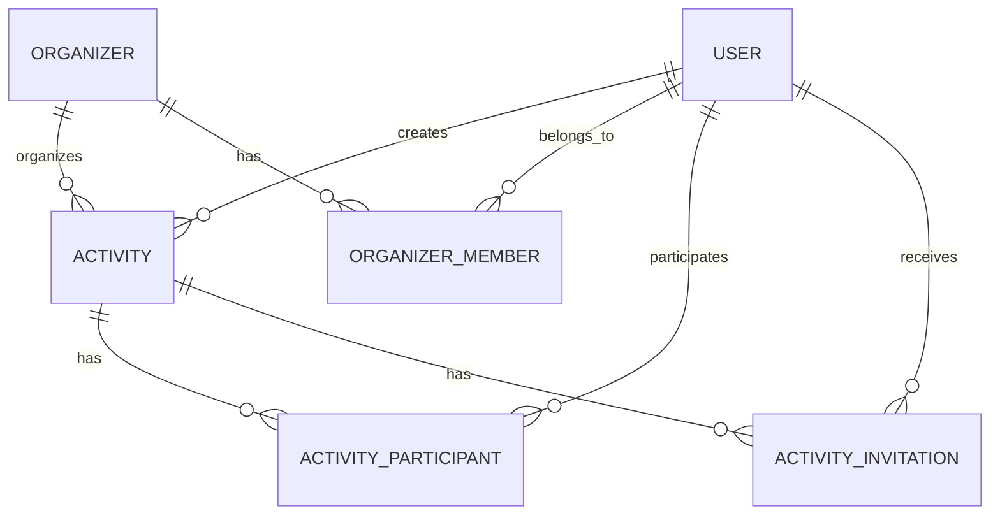

# Datenmodell für Activities

## Ziel

Die App verbindet Menschen mit Aktivitäten in ihrer Stadt. Nutzer können Aktivitäten alleine, als geschlossene Gruppe oder gemeinsam mit neuen Menschen unternehmen. Privatpersonen und Veranstalter wie Bars, Museen oder Sportorganisationen können Angebote erstellen.

Ein gemeinsames Modell `Activity` bildet private Treffen, öffentliche Aktivitäten und Veranstalter-Events ab. Ein separates `Event`-Modell ist zunächst nicht notwendig.

## Grundprinzipien

- **Sichtbarkeit** bestimmt, wer eine Activity entdecken und lesen darf.
- **Beitrittsregel** bestimmt, wie jemand teilnehmen kann.
- **Einladung** und **Teilnahme** sind getrennte Datensätze: Eine Einladung bedeutet noch keine bestätigte Teilnahme.
- Der Veranstaltertyp bestimmt nicht, ob Einladungen notwendig sind.
- Eine Activity kann von privat zu öffentlich wechseln, ohne neu erstellt zu werden. ID, Teilnehmer, Einladungen und Chat bleiben erhalten.

## 1. Activity

| Property | Typ | Bedeutung |
|---|---|---|
| `id` | UUID | Eindeutige ID |
| `created_by_user_id` | User-ID | Nutzer, der die Activity erstellt hat |
| `organizer_id` | Organizer-ID | Verantwortliche Privatperson oder Organisation |
| `title` | String | Titel, beispielsweise „Bowling am Freitag“ |
| `description` | Text | Ablauf und wichtige Informationen |
| `category_id` | Category-ID | Beispielsweise Sport, Kultur oder Essen |
| `cover_image_url` | String, optional | Titelbild |
| `visibility` | Enum | `public`, `invite_only` |
| `join_policy` | Enum | `instant`, `approval_required`, `invitation_required` |
| `max_participants` | Integer, optional | Maximale Teilnehmerzahl; `null` bedeutet unbegrenzt |
| `starts_at` | Timestamp | Beginn |
| `ends_at` | Timestamp, optional | Ende |
| `timezone` | String | Zeitzone, beispielsweise `Europe/Zurich` |
| `city_id` | City-ID | Stadt für Suche und Vorschläge |
| `place_name` | String | Name des Treffpunkts oder Veranstaltungsorts |
| `address` | String, optional | Adresse |
| `latitude` | Koordinate, optional | Breitengrad |
| `longitude` | Koordinate, optional | Längengrad |
| `status` | Enum | `draft`, `active`, `cancelled`, `completed` |
| `first_published_at` | Timestamp, optional | Erste öffentliche Freigabe; vorher `null` |
| `visibility_changed_at` | Timestamp | Letzte Änderung der Sichtbarkeit |
| `created_at` | Timestamp | Erstellung |
| `updated_at` | Timestamp | Letzte Änderung |

### Sichtbarkeit und Beitritt

| Sichtbarkeit | Erlaubte Beitrittsregel | Verhalten |
|---|---|---|
| `invite_only` | `invitation_required` | Nur ausdrücklich eingeladene Nutzer dürfen beitreten |
| `public` | `instant` | Nutzer können direkt beitreten, sofern Plätze frei sind |
| `public` | `approval_required` | Nutzer fragen an; ein berechtigter Gastgeber bestätigt |

Öffentliche, aktive Activities dürfen in Suche und Empfehlungen erscheinen. Welche tatsächlich vorgeschlagen werden, entscheidet die spätere Such- und Empfehlungslogik.

Private Activities sind für berechtigte Organisatoren, eingeladene Nutzer und bestehende Teilnehmer zugänglich. Eine Freundschaft allein berechtigt nicht zum Zugriff oder Beitritt.

### Status

- `draft`: Noch nicht freigegeben; nur für berechtigte Organisatoren sichtbar.
- `active`: Für die jeweilige Zielgruppe verfügbar, privat oder öffentlich.
- `cancelled`: Abgesagt; keine neuen Beitritte.
- `completed`: Abgeschlossen; keine neuen Beitritte.

Der Name `active` ersetzt das zuvor besprochene `published`, damit Status und öffentliche Sichtbarkeit nicht verwechselt werden.

## 2. ActivityParticipant

Diese Tabelle beschreibt Teilnahmeanfragen und Teilnahmen.

| Property | Typ | Bedeutung |
|---|---|---|
| `activity_id` | Activity-ID | Zugehörige Activity |
| `user_id` | User-ID | Nutzer |
| `role` | Enum | `host`, `co_host`, `participant` |
| `status` | Enum | `requested`, `confirmed`, `waitlisted`, `cancelled`, `rejected`, `removed` |
| `requested_at` | Timestamp | Zeitpunkt der Anmeldung |
| `confirmed_at` | Timestamp, optional | Zeitpunkt der Bestätigung |
| `updated_at` | Timestamp | Letzte Änderung |

### Regeln

- Die Kombination aus `activity_id` und `user_id` ist eindeutig.
- Direkter Beitritt erzeugt den Status `confirmed`, sofern ein Platz verfügbar ist.
- Bei erforderlicher Zustimmung beginnt die Teilnahme mit `requested`.
- Nur `confirmed` zählt gegen das Teilnehmerlimit.
- Teilnehmende Gastgeber und Co-Gastgeber zählen ebenfalls gegen das Limit.
- Ein Veranstalter, der nur organisiert, benötigt keinen Teilnehmereintrag. Seine Verwaltungsrechte folgen aus seiner Organizer-Zugehörigkeit.
- Bei erneuter Anmeldung wird der vorhandene Datensatz aktualisiert; es entsteht kein Duplikat.
- `waitlisted` kann für eine spätere Wartelistenfunktion genutzt werden. Eine automatische Nachrücklogik gehört nicht zwingend zur ersten Version.

## 3. ActivityInvitation

Diese Tabelle beschreibt ausdrückliche Einladungen an bestimmte Nutzer.

| Property | Typ | Bedeutung |
|---|---|---|
| `id` | UUID | Eindeutige Einladungs-ID |
| `activity_id` | Activity-ID | Zugehörige Activity |
| `invited_user_id` | User-ID | Eingeladener Nutzer |
| `invited_by_user_id` | User-ID | Einladender Nutzer |
| `status` | Enum | `pending`, `accepted`, `declined`, `revoked`, `expired` |
| `expires_at` | Timestamp, optional | Ablaufdatum |
| `created_at` | Timestamp | Erstellung |
| `updated_at` | Timestamp | Letzte Änderung |

### Regeln

- Eine Einladung erzeugt noch keine bestätigte Teilnahme.
- Beim erfolgreichen Annehmen werden Einladung und Teilnahme gemeinsam aktualisiert: `accepted` beziehungsweise `confirmed`.
- Einladungen reservieren in der ersten Version keine Plätze.
- Beim Annehmen müssen Gültigkeit, Activity-Status und freie Kapazität erneut geprüft werden.
- Ist die Activity voll, wird keine bestätigte Teilnahme erzeugt und die Einladung nicht als erfolgreich angenommen markiert.
- Bei privaten Activities ist eine gültige Einladung erforderlich. Die Freundesliste dient zur Auswahl der einzuladenden Personen.
- Es sollte höchstens eine offene Einladung pro Activity und eingeladenem Nutzer geben.
- Eine Einladung kann auch zu einer öffentlichen Activity existieren. Für die erste Version gilt sie als ausdrückliche Zulassung: Beim Annehmen ist keine zusätzliche Gastgeberbestätigung notwendig, das Teilnehmerlimit gilt weiterhin.

## 4. Organizer

Ein Organizer repräsentiert die verantwortliche Privatperson oder Organisation.

| Property | Typ | Bedeutung |
|---|---|---|
| `id` | UUID | Eindeutige Veranstalter-ID |
| `type` | Enum | `person`, `organization` |
| `user_id` | User-ID, optional | Verknüpfter Nutzer bei einer Privatperson |
| `name` | String | Öffentlicher Name |
| `description` | Text, optional | Vorstellung |
| `avatar_url` | String, optional | Profilbild oder Logo |
| `website_url` | String, optional | Website |
| `verified_at` | Timestamp, optional | Zeitpunkt einer Prüfung durch die Plattform |
| `created_at` | Timestamp | Erstellung |

Bei `person` muss `user_id` gesetzt sein, bei `organization` bleibt es leer. Pro Nutzer ist ein persönlicher Organizer vorgesehen.

`created_by_user_id` und `organizer_id` erfüllen unterschiedliche Aufgaben: Die Bar ist der Veranstalter, ein konkreter Mitarbeiter hat die Activity angelegt.

## 5. OrganizerMember

Damit mehrere Mitarbeiter eine Organisation verwalten können:

| Property | Typ | Bedeutung |
|---|---|---|
| `organizer_id` | Organizer-ID | Organisation |
| `user_id` | User-ID | Mitarbeiter |
| `role` | Enum | Beispielsweise `owner`, `admin`, `editor` |
| `created_at` | Timestamp | Aufnahme in die Organisation |

Die Kombination aus `organizer_id` und `user_id` ist eindeutig. Welche Rollen Activities und Einladungen verwalten dürfen, wird serverseitig festgelegt.

## Beziehungen

`User`, `City` und `Category` sind referenzierte Modelle und werden in diesem Dokument nicht im Detail definiert.

## Typische Szenarien

| Szenario | Organizer | Visibility | Join Policy | Limit |
|---|---|---|---|---|
| Bowling mit eingeladenen Freunden | Person | `invite_only` | `invitation_required` | Beispielsweise 8 |
| Offener Dartsabend | Person | `public` | `instant` | Beispielsweise 8 |
| Wanderung mit Teilnahmebestätigung | Person | `public` | `approval_required` | Beispielsweise 12 |
| Öffentliches Volleyballturnier | Organisation | `public` | `instant` oder `approval_required` | Nach Bedarf |
| Privater Empfang einer Bar | Organisation | `invite_only` | `invitation_required` | Nach Bedarf |

### Öffentliches Event eines Veranstalters

Eine Bar erstellt einen öffentlichen Dartsabend:

1. Die Activity verweist über `organizer_id` auf die Bar.
2. Beitritte erzeugen `ActivityParticipant`-Einträge.
3. Es entstehen keine `ActivityInvitation`-Einträge, solange niemand ausdrücklich eingeladen wird.

## Von privat zu öffentlich wechseln

Beispiel: Ein Bowlingabend hat acht Plätze, aber erst vier bestätigte Teilnehmer.

1. Die Activity startet mit `visibility = invite_only` und `join_policy = invitation_required`.
2. Freunde werden eingeladen und bestätigen ihre Teilnahme.
3. Der Gastgeber wählt „Öffentlich machen“.
4. Er entscheidet zwischen direktem Beitritt und Teilnahme auf Anfrage.
5. Der Server ändert `visibility` auf `public` und setzt die gewählte `join_policy`.
6. `visibility_changed_at` wird aktualisiert. `first_published_at` wird nur gesetzt, wenn es bisher leer war.
7. Die Activity erscheint in der öffentlichen Entdeckung. Vier Plätze sind noch verfügbar.

Activity-ID, bestätigte Teilnehmer, bestehende Einladungen und Chat bleiben erhalten. Bereits offene Einladungen bleiben gültig, reservieren aber keine Plätze.

Vor der Veröffentlichung zeigt die App, welche Informationen öffentlich werden, insbesondere Ort und Beschreibung. Die Teilnehmerliste wird unabhängig von der Activity-Sichtbarkeit geschützt. Öffentlich kann zunächst nur die Belegung erscheinen, beispielsweise „4 von 8 Plätzen belegt“.

## Wieder privat machen

- `visibility` wechselt zu `invite_only`.
- `join_policy` wechselt zu `invitation_required`.
- Die Activity verschwindet aus öffentlicher Suche und Empfehlungen.
- Bereits bestätigte Teilnehmer bleiben dabei und behalten Zugriff, auch wenn sie öffentlich beigetreten sind.
- Neue Teilnehmer benötigen eine Einladung.
- Noch offene öffentliche Teilnahmeanfragen werden in der vorgeschlagenen ersten Version abgelehnt. Die Änderung wird im Dialog vorab erklärt.
- `first_published_at` bleibt als historische Angabe erhalten.

Eine zuvor öffentliche Activity kann bereits gesehen oder geteilt worden sein; der Wechsel verhindert zukünftigen öffentlichen Zugriff, macht frühere Offenlegung aber nicht rückgängig.

## Technische Regeln für die Umsetzung

- Zugriff und Beitritt werden serverseitig geprüft. Das Ausblenden in der Oberfläche reicht nicht aus.
- Kapazitätsprüfung und Bestätigung erfolgen in einer Datenbanktransaktion mit geeigneter Sperre oder gleichwertiger atomarer Absicherung. Zwei gleichzeitige Anmeldungen dürfen nicht denselben letzten Platz erhalten.
- Das Limit muss positiv sein oder `null`. Es darf nicht unter die aktuelle Zahl bestätigter Teilnehmer gesenkt werden.
- Ein Ende darf nicht vor dem Beginn liegen. Zeitpunkte werden als eindeutige Zeitinstanzen gespeichert; die separate Zeitzone dient zur lokalen Darstellung.
- Sichtbarkeit und Beitrittsregel werden gemeinsam atomar geändert und auf erlaubte Kombinationen geprüft.
- Fremdschlüssel und eindeutige Constraints sichern die Beziehungen und verhindern doppelte Teilnahmen.
- Sinnvolle Indizes sind öffentliche Activities nach Stadt, Status und Beginn, Teilnehmer nach Activity und Status sowie Einladungen nach Empfänger und Status.
- Chat, Tickets, Zahlungen, Turnierregeln, wiederkehrende Termine und Entdeckungsaufgaben können später als eigene verknüpfte Modelle ergänzt werden.

## Aktueller Implementierungsstand

Das Backend verwendet inzwischen Supabase/PostgreSQL. Persönliche Aktivitäten, Kategorien, die Pilotstadt Zürich, Teilnahmen und Freundeseinladungen sind in `supabase/migrations/202611070004_activities.sql` implementiert. Geschützte RPCs übernehmen Erstellung, Statusantworten, Veröffentlichung und Teilnahmefreigaben; direkte Tabellenänderungen sind für App-Nutzer gesperrt.

Die fünf Beispielaktivitäten der Oberfläche sind getrennte lokale Vorschauen. Eigene Aktivitäten werden dauerhaft gespeichert. `organizer_id` verweist bei persönlichen Aktivitäten vorläufig auf das Nutzerprofil. Das gemeinsame Organizer-Modell mit Organisationen wird separat mit dem Organizer-Backend integriert. Suche, Chat und vollständige nachträgliche Bearbeitung sind noch nicht umgesetzt.
